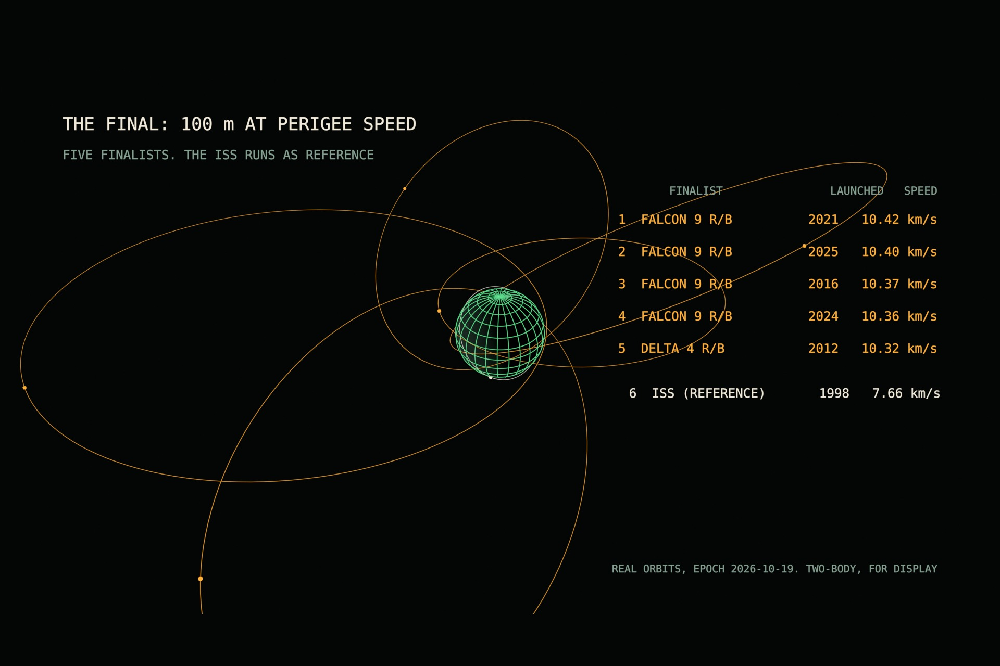

# VELOCITY

Two short films for the RenderJuice Blender Animation & Programmatic Rendering Contest (theme: Speed). Everything on screen is generated by Python in Blender 5.2, from an empty scene. No modelling, no sculpting, no hand keyframes.

- **[orbital/](orbital/) - VELOCITY // 100 M ORBITAL, the contest entry.** 12,379 real orbits, qualifying heats, and a 100 m race between old rocket stages and the ISS. Video: https://youtu.be/bkjEwBM9kNo
- `scripts/`, `tools/`, `data/` - VELOCITY // FLIGHT TEST 001, the earlier film (one bullet, five reference frames). The orbital film reuses its modules.



The spec and the code were written with AI assistance (Claude). Font: DejaVu Sans Mono, bundled with Blender.

---

## VELOCITY // FLIGHT TEST 001 (earlier film)

One bullet. Five reference frames. It gets 1,300 times faster without anything touching it.

24 s, 1920x1080, 24 fps. Blender 5.2 + Python. Everything on screen is generated by script from an empty scene.

## Rebuild

```bash
python tools/frames.py                                    # astropy -> data/frames.json
blender -b --python scripts/build.py -- --validate        # build + checks, no render
blender -b --python scripts/build.py -- --preview         # 960x540, output/preview/
blender -b --python scripts/build.py -- --final --save-blend project/velocity.blend
blender -b --python scripts/encode.py                     # output/frames -> output/final/*.mp4 (+ audio)
```

Other options: `--start N --end M`, `--stills 60,200,470`, `--seed N`. The build is deterministic: same inputs, same film.

No external ffmpeg is needed; `encode.py` uses Blender's built-in FFmpeg.

## The numbers (epoch 2026-10-31T23:59:00Z, 60.9 N, fired due east)

| Frame | Speed | Method |
|---|---|---|
| Ground | 0.305 km/s | Federal AE9FP 147 gr FMJ, 1000 ft/s |
| Earth-centred (GCRS) | 0.532 km/s | astropy ITRS -> GCRS |
| Sun-centred (HCRS) | 30.5 km/s | astropy GCRS -> HCRS |
| Galactocentric | 235 km/s | astropy Galactocentric, "latest" defaults |
| CMB rest frame | 393 km/s | HCRS + Planck 2018 dipole |

Span: x1,300 (the spec's provisional x1,200 assumed 370 km/s; at this epoch Earth's orbital motion adds to the dipole). The site is on the night side at the deadline, so Earth's rotation adds to its orbital velocity, and the globe's terminator is drawn from the real Sun direction.

Provenance for every displayed number: `data/sources.md`. Two values still say VERIFY there (test-barrel length, Pioneer 10 at the epoch).

## What the system controls

- `tools/frames.py`: all speeds, the span ratio, the Sun direction for the terminator.
- `data/timeline.json`: segments, zoom gaps and durations, event offsets, pass timings, slow-motion factor (1:1200, so a 1-in-10 in twist reads as 1 rev/s of visible rifling spin).
- `data/hud_layout.json`: every HUD anchor in screen pixels.
- `scripts/timeline.py`: the log-zoom curve, handoff frames (first frame the inner hero drops below 6 px), layer visibility.
- `scripts/anim.py`: every animated value is a function of the frame number, sampled and baked to F-Curves. No hand keyframes, no frame handlers.
- `scripts/validation.py`: sources, units and frames on every number, segment overlap, 28 px text, title-safe area, 1.2 s readability, layer isolation, seeded randomness.

The camera never moves. Each scale layer is scaled about the anchor on the left third line, which is optically the same as dollying a pinhole camera. Thin lines keep a constant pixel width because curve bevel depths are baked against the layer scale.

## Deviations from the spec, on purpose

- Saturn V at TLI is drawn as the S-IVB + spacecraft stack, because that is all that is left at translunar injection. One J-2 bell, not five.
- The ruler in the macro shot keeps a single continuous clock, so the return shot shows the bullet further downrange (about 5 m) at the same slow motion.
- Fonts: Blender's bundled DejaVu Sans Mono.

## Disclosure (draft)

No third-party visual assets, textures, models or fonts beyond Blender's bundled fonts. Geometry, animation, materials, lighting, typography and audio are generated by script. The specification and code were written with AI assistance (Claude). No AI-generated imagery or audio.
